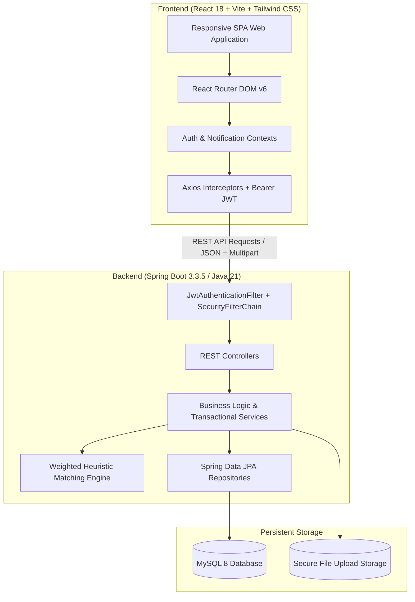
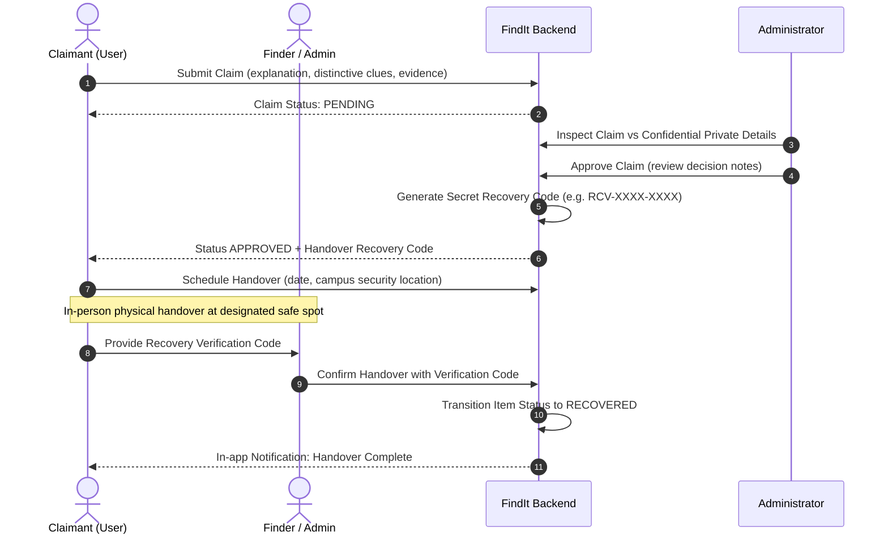

# FindIt – Smart Lost & Found Platform Architecture

## 1. System Overview
FindIt is a production-grade full-stack platform that centralizes lost and found reporting for universities, corporate offices, and local communities. It solves the fragmentation of manual lost-and-found processes by combining **role-based access control**, **heuristic weighted matching**, **confidential clue masking**, and a **cryptographic handover recovery verification workflow**.

---

## 2. Key Architectural Modules

### 2.1 Authentication & Role-Based Authorization
- **Stateless JWT Security**: JJWT 0.12.6 with HMAC-SHA256 signatures and claims for `sub`, `userId`, `role`, and `fullName`.
- **BCrypt Password Hashing**: Passwords stored as BCrypt salted hashes (strength 10).
- **Three-Tier RBAC**:
  - `ROLE_USER`: Can submit lost/found reports, view matches, submit claims for found items, coordinate handovers.
  - `ROLE_ADMIN`: Can moderate all reports, review ownership claims, view confidential item clues, approve/reject claims, view platform telemetry.
  - `ROLE_SUPER_ADMIN`: Administrative superpowers, manage administrator roles, review system audit trail logs.

### 2.2 Public Masking of Sensitive Clues
To eliminate fraudulent claims:
- Found item reports accept a **`publicDescription`** and **`privateDetails`**.
- The `ItemMapper` evaluates the requesting user: only the original finder or authorized administrators (`ROLE_ADMIN`, `ROLE_SUPER_ADMIN`) receive `privateDetails`.
- Unauthenticated visitors and general community members receive `privateDetails: null`.

---

## 3. Heuristic Smart Matching Engine

The core differentiator of FindIt is its **100-Point Weighted Heuristic Engine**:

$$\text{Score} = \sum_{i=1}^{n} w_i \cdot s_i$$

| Parameter | Max Points | Evaluation Algorithm |
| :--- | :---: | :--- |
| **Category Compatibility** | 25 | Strict match across compatible categories; 0 if incompatible |
| **Title Token Similarity** | 20 | Case-insensitive tokenization with Jaccard and word-overlap scoring |
| **Brand Similarity** | 15 | Levenshtein distance $\le 1$ or substring match |
| **Color Similarity** | 10 | Exact or normalized color keyword matching |
| **Location Proximity** | 15 | Building/room token overlap and campus zone proximity |
| **Date Proximity** | 10 | Date decay: 10 pts $\le 1$ day; 8 pts $\le 3$ days; 5 pts $\le 7$ days; 2 pts $\le 14$ days |
| **Keyword Description** | 5 | Description keyword and token intersection |
| **Total Possible** | **100** | Max score |

### Match Classifications:
- **Strong Match ($\ge 80$ points)**: Generates high-priority in-app and email notifications.
- **Possible Match ($60 - 79$ points)**: Displayed with amber alert badges.
- **Weak Match ($< 60$ points)**: Displayed as lower confidence reference.

---

## 4. Ownership Claim & Secure Recovery Workflow

