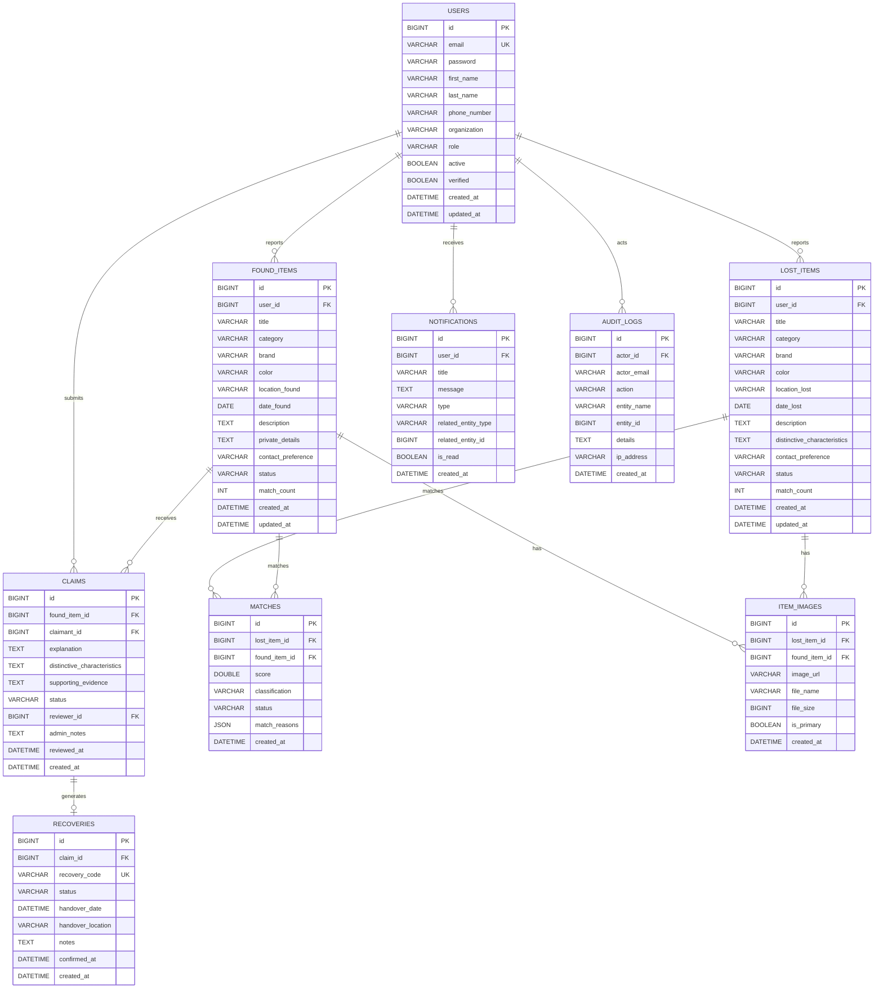

# FindIt – Database Schema Documentation

## 1. Overview
The FindIt database runs on **MySQL 8.0** (`findit_db`) using `utf8mb4` encoding. It incorporates full relational integrity, foreign key constraints, indexed lookup columns, and auditing timestamps (`created_at`, `updated_at`).

---

## 2. Table Specifications & Constraints

### 2.1 `users`
- `email`: `VARCHAR(191)` unique index, case-insensitive collation.
- `role`: Enum mapping to `ROLE_USER`, `ROLE_ADMIN`, `ROLE_SUPER_ADMIN`.
- `password`: BCrypt hash (60 chars).

### 2.2 `lost_items` & `found_items`
- Indexes on `(category, status)`, `date_lost`, `date_found`, and `user_id`.
- `private_details` in `found_items`: Holds sensitive confidential ownership clues, never emitted on public API responses.

### 2.3 `matches`
- Unique composite index on `(lost_item_id, found_item_id)` to prevent redundant match evaluation.
- `score`: Double value between `0.0` and `100.0`.
- `match_reasons`: Stored as serialized JSON lines.

### 2.4 `claims` & `recoveries`
- Foreign keys ensure a user cannot submit claims on items they reported found.
- `recoveries.recovery_code`: Formatted as `RCV-XXXX-XXXX`, indexed and uniquely constrained.
- Handover confirmation requires the claimant to supply this exact code.
